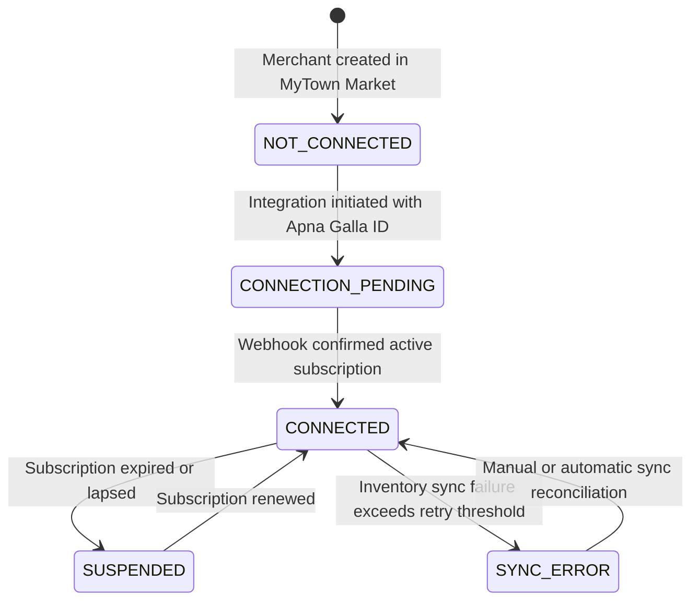
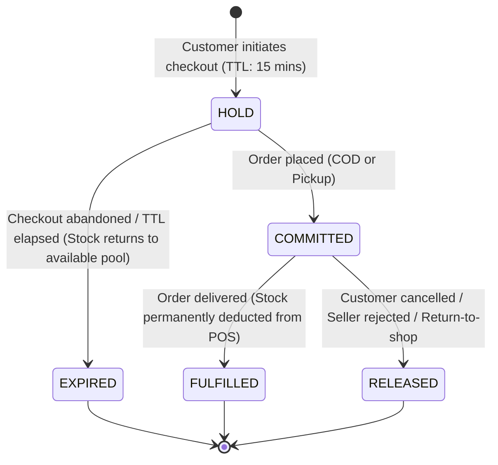
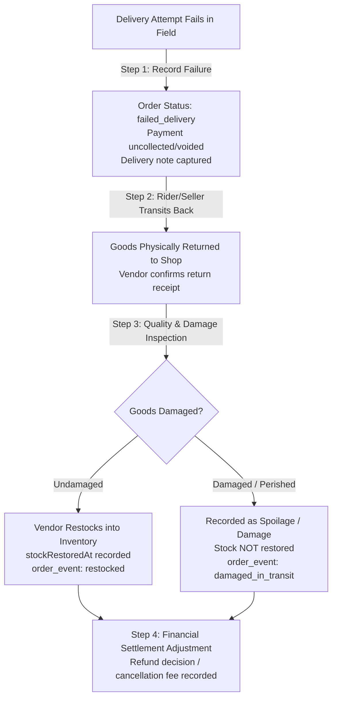

# Apna Galla ⇄ MyTown Market — Integration Contract & API Specification

**Contract Version:** 1.1.0-draft  
**Specification Date:** November 4, 2026  
**Status:** Architecture Proposal / Draft for Review (Requires Owner & Apna Galla Sign-off)  
**Parties:** Apna Galla (Retail Billing & Inventory SaaS) and MyTown Market (Hyperlocal Marketplace Platform)  

---

## 1. Architectural Boundaries & System Roles

### 1.1 Authoritative System of Record
- **Apna Galla ERP** is the **authoritative system of record** for:
  - Merchant business identity, legal GSTIN, and retail billing accounts.
  - SaaS subscription status and marketplace eligibility tier.
  - Master retail catalog, barcode mappings, and MRP.
  - In-store physical inventory levels and stock reservation commits.
  - Merchant general ledger, Khata, and overall retail accounting.
- **MyTown Market** is the **consumer-facing storefront and order orchestration engine**, authoritative for:
  - Consumer identities, delivery addresses, and town service zones.
  - Store discovery, consumer search, and storefront presentation.
  - Consumer shopping carts, price snapshots, and order placement.
  - Delivery dispatch, customer handover proof (HMAC-SHA256 codes), and COD cash tracking.
  - Marketplace commissions, delivery fees, and platform settlement reconciliation.

### 1.2 Non-Duplication Rule
MyTown Market **must not** duplicate retail POS billing, Khata accounting, vendor ledger debt tracking, or in-store barcode management. MyTown Market consumes inventory and catalog snapshots from Apna Galla and reports online customer order events back to Apna Galla.

---

## 2. Merchant Lifecycle & Eligibility States

In production, a merchant can only sell on MyTown Market if they maintain an active, eligible Apna Galla SaaS subscription with the Marketplace feature enabled.



### 2.1 Merchant Integration States
1. **`NOT_CONNECTED`**: Merchant exists locally (e.g. standalone test merchant or initial draft profile). Cannot sell in public production mode.
2. **`CONNECTION_PENDING`**: Apna Galla subscriber ID linked; awaiting subscription verification handshake.
3. **`CONNECTED`**: Verified active subscriber. Storefront is active and eligible to go online (`isOpen: true`).
4. **`SUSPENDED`**: Subscription lapsed or terminated in Apna Galla; marketplace storefront is automatically hidden from consumers (`isOpen: false`).
5. **`SYNC_ERROR`**: Automated inventory or catalog synchronization failed. Requires operator attention; orders temporarily paused for affected items.

> [!CRITICAL]
> ### Production Guard Rule
> Merchant subscription test bypasses (`isAuthorizedTestMerchant: true`) are strictly restricted to local development and isolated sandbox environments (`NODE_ENV !== "production"`). Under no circumstances may a test merchant bypass be enabled or permitted to sell publicly in production. In production, public selling strictly requires `integrationStatus === "CONNECTED"` and an active, verified Apna Galla subscription tier.

---

## 3. Communication Protocol, Hosting & Authentication

### 3.1 Endpoint Hosting Matrix

| Endpoint | Hosted By | Called By | Protocol | Purpose |
| :--- | :--- | :--- | :--- | :--- |
| `POST /api/v1/merchants/verify` | **Apna Galla ERP** | MyTown Market | Synchronous REST | Verify merchant subscription validity & tier |
| `POST /api/v1/inventory/reserve` | **Apna Galla ERP** | MyTown Market | Synchronous REST | Create temporary checkout stock hold (TTL 15m) |
| `POST /api/v1/inventory/commit` | **Apna Galla ERP** | MyTown Market | Synchronous REST | Convert hold into committed stock upon order placement |
| `POST /api/v1/inventory/release` | **Apna Galla ERP** | MyTown Market | Synchronous REST | Release stock on cancellation or return-to-shop |
| `POST /api/v1/orders/sale-post` | **Apna Galla ERP** | MyTown Market | Asynchronous REST | Post final retail sale & stock deduction on delivery |
| `POST /api/v1/webhooks/catalog-sync` | **MyTown Market** | Apna Galla ERP | Inbound Webhook | Push catalog, pricing, and master inventory updates |
| `POST /api/v1/webhooks/subscription` | **MyTown Market** | Apna Galla ERP | Inbound Webhook | Push subscription renewal, upgrade, or expiry events |
| `GET /api/v1/reconciliation/audit` | **MyTown Market** | Both / Worker | Batch Query | Daily audit comparing order states and stock counts |

### 3.2 Security & Authentication
- **Transport:** HTTPS with TLS 1.3 only.
- **Authentication:** Dual-layer security:
  - Header `X-Apna-Galla-Key`: Platform API key.
  - Header `X-Apna-Galla-Signature`: HMAC-SHA256 signature calculated over `timestamp + "." + rawRequestBody` using a shared webhook secret.
  - Header `X-Apna-Galla-Timestamp`: Epoch seconds to prevent replay attacks (requests older than 300 seconds are rejected).
- **Idempotency:** Header `Idempotency-Key` (UUIDv4) required on all state-mutating requests.

---

## 4. Complete Inventory Reservation & Fulfillment Lifecycle

To handle real-world hyperlocal scenarios—where Cash on Delivery (COD) orders remain in transit or packing for hours—the inventory lifecycle consists of 5 explicit phases:



### 4.1 Phase 1: Temporary Hold (`HOLD`)
- **Trigger:** Customer opens checkout review page.
- **Action:** MyTown Market calls Apna Galla `POST /api/v1/inventory/reserve`.
- **Duration:** Temporary TTL (default: 15 minutes).
- **Effect in Apna Galla:** `available_stock = physical_stock - active_holds - committed_stock`.

### 4.2 Phase 2: Allocation Commit (`COMMITTED`)
- **Trigger:** Customer successfully places order (COD or Pickup).
- **Action:** MyTown Market calls Apna Galla `POST /api/v1/inventory/commit`.
- **Duration:** **Permanent until fulfillment or cancellation.** The order is immune to the 15-minute checkout TTL.
- **Effect in Apna Galla:** Hold converts to committed stock. Even if delivery takes 4 hours or the customer delays pickup until evening, the stock remains locked and cannot be sold at the retail counter.

### 4.3 Phase 3: Hold Expiration (`EXPIRED`)
- **Trigger:** Customer abandons cart or checkout fails before order placement.
- **Action:** Apna Galla expires the hold automatically after 15 minutes without an order commit. Stock returns to available pool.

### 4.4 Phase 4: Delivery Fulfillment (`FULFILLED`)
- **Trigger:** Order delivered or picked up with verified customer handover code.
- **Action:** MyTown Market calls Apna Galla `POST /api/v1/orders/sale-post`.
- **Effect in Apna Galla:** Physical inventory is permanently decremented; sale entry is posted to the merchant's retail billing ledger.

### 4.5 Phase 5: Stock Release (`RELEASED`)
- **Trigger:** Order cancelled, seller rejected, or returned to shop after failed delivery.
- **Action:** MyTown Market calls Apna Galla `POST /api/v1/inventory/release`.
- **Effect in Apna Galla:** Committed stock is restored to available inventory.

---

## 5. Financial & Commission Mechanics

### 5.1 Commission Accrual vs. Cash Collection
1. **Order Placed:** Commission is estimated and snapshotted (`orders.commissionPaise`). No money moves.
2. **Order Delivered (COD or Pickup):**
   - The customer pays the order total (₹Total) in cash directly to the merchant.
   - The platform has **NOT** received its commission.
   - Marketplace commission (`commissionPaise`) and platform fees (`platformFeePaise`) are **ACCRUED** as platform receivables.
   - The merchant now holds platform cash and has an outstanding settlement obligation to the platform.
3. **Order Cancelled / Returned:**
   - Any uncollected payment record is voided.
   - Accrued commission is reversed; no receivable exists.

### 5.2 Settlement Statement Formula
On periodic settlement dates (e.g., weekly or monthly):
$$\text{Net Merchant Payable} = \text{Prepaid Online Sales} - \text{COD Cash Retained by Seller} - \text{Marketplace Commissions} - \text{Platform Fees}$$

- If Net Merchant Payable is **negative**, the seller owes cash to MyTown Market.
- If Net Merchant Payable is **positive**, MyTown Market disburses payouts to the seller.
- **Rule:** A seller collecting COD does not mean the platform has received its commission. Settlement events must be recorded separately from order delivery events.

---

## 6. Separate Auditable Steps for Failed Deliveries & Returns

To prevent inventory shrinkage and maintain audit integrity, delivery failure, return-to-shop, and stock restoration must never be merged into a single atomic action:



1. **Step 1: Failed Delivery:** Rider or seller marks `failed_delivery` with standardized reason. Payment status remains uncollected/voided. Stock remains in transit.
2. **Step 2: Return to Shop:** Merchant physically inspects returned parcel upon arrival at store.
3. **Step 3: Stock Restoration Decision:** Only intact, saleable goods are restored to inventory (`stockRestoredAt: new Date()`). Damaged/spoiled goods are audited as shrinkage.
4. **Step 4: Financial & Ledger Reconciliation:** Final settlement adjustment is posted to the ledger with an audit entry.

---

## 7. Distributed Failure Handling (No 2PC Assumed)

Because Apna Galla ERP and MyTown Market run on separate infrastructure, **no distributed transactions or two-phase commit (2PC) are assumed**.

### 7.1 Outbox Pattern & Asynchronous Relay
- All outbound events (order commits, stock releases, sales) are written to a local `integration_outbox` table in the same database transaction as the order mutation.
- A background worker polls the outbox and dispatches HTTP requests with exponential backoff:
  $$\text{Delay} = \min(60, 2^{\text{attempt}} + \text{jitter}) \text{ seconds}$$
- Maximum retries: 5. If failed after 5 retries, status is set to `SYNC_ERROR` and an alert is flagged for operator reconciliation.

### 7.2 Idempotent Deduplication
- Every request carries an `Idempotency-Key` (UUIDv4).
- If Apna Galla or MyTown Market receives a duplicate key, it returns the cached response without re-executing stock or money mutations.

### 7.3 Daily Audit & Reconciliation Job
- A daily automated job compares active order counts and stock balances between MyTown Market and Apna Galla, logging discrepancies to an audit report.

---

## 8. Standalone Mock vs. Production Adapter

```typescript
export interface IApnaGallaAdapter {
  verifyMerchant(merchantId: string): Promise<{
    isValid: boolean;
    tier: string;
    expiresAt: Date;
  }>;
  reserveStock(input: {
    orderNumber: string;
    merchantId: string;
    items: Array<{ sku: string; quantity: number }>;
  }): Promise<{ reservationId: string; success: boolean }>;
  commitStock(reservationId: string, orderNumber: string): Promise<{ success: boolean }>;
  releaseStock(reservationId: string, reason: string): Promise<void>;
  postSale(order: any): Promise<{ invoiceNumber?: string; success: boolean }>;
}
```

During Phase 1 and standalone pilot development, `StandaloneMockApnaGallaAdapter` operates locally without external HTTP calls. In Phase 7 production rollout, `HttpApnaGallaAdapter` is activated.
