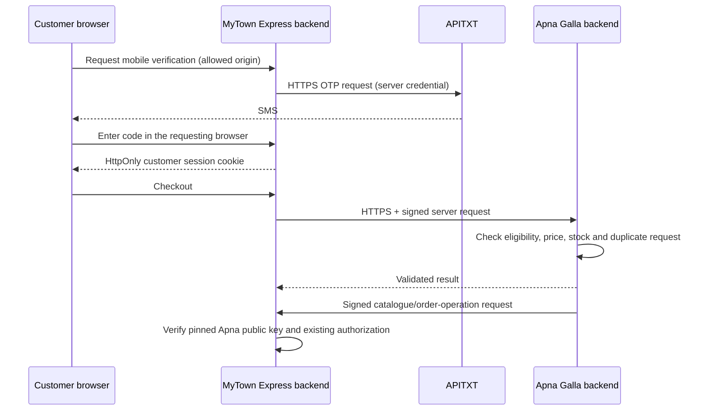

# Customer login and the Apna Galla server connection

Verified locally on 6 November 2026. No production deployment or Git push was performed.

## Two separate identities

Customers use MyTown mobile-number OTP login. Shop owners continue using their existing Apna Galla accounts. A customer OTP account is always a customer, never a merchant or platform administrator. Existing OAuth support remains; email/contact-number edits do not silently merge accounts or change the verified login number.

The servers authenticate each other independently of these human accounts. Never share a shop owner's password, customer cookie, database password, or JWT signing secret between applications.



## Customer authentication

- Six-digit cryptographically generated codes expire after five minutes. Only a keyed digest is stored in the database. No OTP is returned through the API or logged.
- Challenges are bound to an HttpOnly cookie in the requesting browser. Resending invalidates earlier challenges; a consumed code cannot be reused.
- Persisted limits: a 30-second resend delay; five requests per phone and twenty per IP per hour; verification limited to twenty per phone and sixty per IP per hour. Five incorrect codes lock the challenge. Rate-limit identifiers are keyed hashes.
- Sessions use random opaque tokens; only their SHA-256 hashes are stored. Cookies are HttpOnly, SameSite=Lax, Path=/; production cookies are Secure and use the `__Host-` prefix. No customer token is stored in localStorage.
- Sessions have a thirty-day absolute and seven-day idle lifetime, at most five active sessions per customer. Normal server restarts preserve them. Sign-out revokes the database session, including a copied cookie.
- Explicit allowed origins protect OTP endpoints and authenticated mutations. Production requires HTTPS origins.
- Migration `0011_customer_mobile_auth.sql` is additive. It adds separate identities, challenges, limits and sessions; it does not reset existing accounts or customer records.
- The local SMS simulator is rejected in production, on non-loopback databases, or when the database name does not end in `_test`. Production must use APITXT.
- The first implementation accepts Indian mobile numbers only. International SMS requires provider coverage and explicit phone validation work before claiming support.

## Server identity and request protection

Each backend owns an Ed25519 private key. The other backend receives only its public verification key. Private keys never go into Vite variables, browser code, Android assets or Git.

The signature covers sender, key ID, POST method, exact path, timestamp, UUID request ID and SHA-256 of the exact body. The receiver pins the sender's public key, rejects a timestamp outside 120 seconds and rejects changed/missing proofs. Both servers need synchronized clocks. Bodies are limited to 64 KiB.

The existing sandbox HMAC authorization, TLS checks, subscriber eligibility, durable checkout idempotency, inventory validation and catalogue-version controls remain. Ed25519 is an additional identity check, not a replacement for authorization or HTTPS. A signature alone is not a one-use nonce: safe repeats rely on existing durable business idempotency/version handling. An unset link mode retains legacy compatibility; explicitly configure `ed25519-v1` on BOTH backends to require the new proofs.

## Where credentials come from

The app-to-app credentials are generated by us, not purchased from an external API provider:

```powershell
node scripts/generate-service-credentials.mjs '<absolute private folder outside the source repository>' production
```

This creates `apna-service.env` and `mytown-service.env`. It refuses to overwrite existing keys. Protect the output folder with owner-only permissions, keep a secure backup, and keep keys stable between routine deployments. The task's actual generated files have Windows owner-only ACLs. Never attach them to a ZIP or paste their contents into a chat.

The APITXT key is different: obtain it from the owner's APITXT account/API access settings. If a managed OTP template is assigned, use its actual template ID. No invented sender/template values are needed. API acceptance is not a delivery guarantee; perform one owner-approved delivery test before rollout.

| Backend | Environment variable names | Purpose |
| --- | --- | --- |
| Both | `MYTOWN_LINK_AUTH`, `MYTOWN_LINK_SELF`, `MYTOWN_LINK_KEY_ID`, `MYTOWN_LINK_PRIVATE_KEY_B64`, `MYTOWN_LINK_PEER_KEYS_JSON` | Own signing identity and pinned peer public keys |
| MyTown | `MTM_CUSTOMER_AUTH_ENABLED`, `MTM_AUTH_ORIGINS`, `MTM_OTP_SECRET` | Enable customer auth, exact origin allowlist, dedicated OTP pepper |
| MyTown | `MTM_SMS_PROVIDER`, `APITXT_AUTH_KEY`, optional `APITXT_OTP_TEMPLATE_ID` | SMS provider configuration |
| Local test only | `MTM_SMS_TEST_OUTBOX` | Protected simulated SMS inbox; never enable on a public preview |

Generated files contain only the new identity/customer-auth settings. They do NOT replace existing database credentials, URLs, sandbox HMAC settings or deployment configuration. Preserve those separately.

## Hosting and rollout checklist

1. Choose the MyTown HTTPS domain and an actual Express backend host. A static frontend host does not execute the Express backend. Serve the customer UI/API on the same origin, or configure a reviewed reverse proxy.
2. Install `apna-service.env` values in the Apna **backend's** secret environment (the existing Render API if that remains the host). Install `mytown-service.env` in the MyTown **backend's** secret environment. Public peer-key JSON is pre-paired in the generated files. Do not put either file in Cloudflare static frontend settings.
3. Set the exact MyTown HTTPS origin in `MTM_AUTH_ORIGINS`; set `MTM_SMS_PROVIDER=apitxt` and the provider key. Keep all development-persona flags disabled and remove simulator configuration. Review trusted reverse-proxy/IP handling before exposure; the app does not blindly trust client-supplied `X-Forwarded-For`.
4. Apply the additive MyTown migration to an isolated staging database first; provision least-privilege runtime database access and retain backups. Test SMS, customer ownership, expiry, logout and checkout before a controlled production migration.
5. Deploy compatible server code/configuration together and verify both directions. The present Apna connector/catalogue is deliberately guarded as a LOCAL SANDBOX: production URL allowlists, authorization scope and rollout validation still need explicit implementation/review. **Do not remove the sandbox guard or call these generated files a live production integration.**
6. Verify the real same-origin deployment with Secure cookies. A packaged Capacitor app must have an explicitly supported origin/API arrangement before release; a localhost browser test is not proof of production Android authentication.
7. Add scheduled retention for expired challenges, limits and sessions after choosing retention requirements. These records are not presently auto-purged. Add monitoring/provider spend controls and phone-recovery/reverification procedures before launch.

For key rotation, first add the new public key to the other server's allowlist, then switch the sender's private key and key ID. Verify traffic and allow in-flight retries to drain before removing the old public key. Up to four pinned peer keys are supported. Do not rotate customer session/database credentials on routine releases.

## Verification in this task

- 258 tests passed across 17 MyTown test files, including original tests, OTP abuse/expiry/reuse/customer-role checks, APITXT failure behavior and Ed25519 tamper/wrong-peer checks.
- TypeScript check, Vite web build and Express bundle passed. The changed Apna backend also typechecked/compiled.
- Eleven paired HTTP checks passed on disposable localhost MySQL/PostgreSQL databases: customer login, origin protection, ownership isolation, signed requests both ways, stock reservation/commit, Apna fulfillment/sale posting and revoked-cookie rejection.
- Headed browser checks passed for OTP login, reload, session restoration after a backend restart and sign-out. Mobile and laptop previews were captured without OTPs or secrets.
- APITXT requests were mocked/simulated in this task. Live SMS, production integration, public deployment and a new authenticated Android release are not claimed.

Security references: [OWASP Authentication Cheat Sheet](https://cheatsheetseries.owasp.org/cheatsheets/Authentication_Cheat_Sheet.html), [OWASP Session Management Cheat Sheet](https://cheatsheetseries.owasp.org/cheatsheets/Session_Management_Cheat_Sheet.html).
