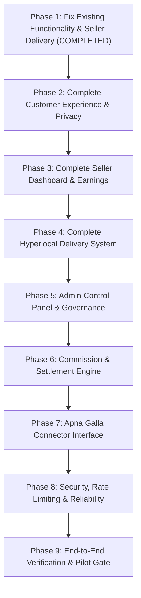

# MyTown Market — Implementation Roadmap & Execution Plan

**Version:** 1.1.0  
**Target Milestone:** Controlled Pilot Launch (Tier-3 Hyperlocal Marketplace)  
**Author:** Senior Full-Stack Engineer & Software Architect  
**Review Status:** Architect Reviewed & Conditionally Approved for Controlled Phase 1  

---

## 1. Roadmap Overview & Strategic Objectives

The goal of this roadmap is to transition MyTown Market from an incomplete prototype into a reliable, commercially usable pilot marketplace ready for its first Indian town, while establishing clean integration boundaries for the **Apna Galla** retail billing and inventory SaaS.

### Core Architectural Principles & Invariants:
1. **Preserve Working Architecture:** Retain React 19 + TypeScript + Vite + Wouter on the client, Express + tRPC on the server, and Drizzle ORM + MySQL.
2. **Prioritize Seller-Managed Delivery & Shop Pickup:** The initial town pilot does not rely on a dedicated platform delivery fleet; shopkeepers manage their own local deliveries or fulfill store pickups.
3. **No Public Test Merchant Bypasses:** Test merchant flags (`isAuthorizedTestMerchant: true`) are strictly restricted to local development and sandbox environments (`NODE_ENV !== "production"`). Public production storefronts strictly require verified Apna Galla subscriptions (`integrationStatus === "CONNECTED"`).
4. **Separate Development Authentication:** Standalone development login (`standaloneLogin`) is strictly isolated to development/pilot environments and disabled when production OAuth is active.
5. **No Distributed Transactions Across Boundaries:** Inventory synchronization and order events between Apna Galla and MyTown Market use the transactional outbox pattern, idempotency keys, and asynchronous reconciliation rather than 2-phase commit (2PC).
6. **Additive Persistence:** All database changes must be strictly additive migrations without dropping tables or overwriting production/operator data.
7. **Isolated Business Logic:** Business rules (pricing in integer paise, state transitions, handover code verification) remain strictly enforced by the server.

---

## 2. Phase-by-Phase Implementation Plan

---

### Phase 1: Fix Existing Functionality & Critical Blockers — COMPLETED & CODE-REVIEW VERIFIED
**Goal:** Repair broken state transitions, fix seller self-delivery, harden development authentication, implement auditable failed delivery recovery, and enforce database test protection.

- [x] **Audit & Verification Baseline:** Complete repository audit and classify all features in `docs/PROJECT_COMPLETION_AUDIT.md`.
- [x] **Fix Vendor Order Delivery Transition & Fulfillment Awareness (Code Review Fix 2):**
  - Updated `server/marketplace/domain.ts` and `server/routers.ts` to enforce fulfillment-type-aware transitions.
  - Pickup: `placed → accepted → preparing → ready → delivered`.
  - Delivery: `placed → accepted → preparing → ready → out_for_delivery → delivered`.
  - Rejected pickup dispatch attempts (`ready → out_for_delivery`), rejected delivery completions without dispatch (`ready → delivered`), and rejected duplicate completion.
  - Enforced conflict rejection when an active platform rider assignment exists on the order.
- [x] **Failed-Delivery Recovery Workflow (Code Review Fix 3):**
  - Delivery failure (`failed_delivery`) preserves inventory without immediate or premature stock restoration.
  - Authored additive non-destructive migration `drizzle/0006_failed_delivery_recovery.sql` adding `returnReceivedAt`, `returnCondition`, and `returnNotes` to `orders`.
  - Implemented `vendor.recordReturnRecovery` and `admin.recordReturnRecovery` for physical parcel return, inspection, and auditable restock vs. shrinkage decisions.
- [x] **Hardened Development Authentication Security (Code Review Fix 1):**
  - Removed client-controlled privilege assignment and arbitrary `openId`/`name`/`email`/`role` parameters from `auth.standaloneLogin`.
  - Replaced with strictly server-controlled test personas (`SERVER_TEST_PERSONAS`: Customer, Vendor, Rider, Admin).
  - Disabled by default (`MTM_ENABLE_DEV_AUTH=1`), forbidden in production (`ENV.isProduction`), and prohibited on remote/shared database hosts or public request origins.
  - Admin test persona requires explicit `ALLOW_DEV_ADMIN_LOGIN=1`.
  - Development sessions are rejected by production `authenticateRequest` in `server/_core/sdk.ts`.
- [x] **Integration Test Database Protection (Code Review Fix 4):**
  - Authored dedicated `server/marketplace/integration-guard.ts` with URL parsing requiring permitted local hosts (`localhost`, `127.0.0.1`, `::1`) and strict `mtm_e2e_` database name prefix.
  - Eliminated dangerous substring matching across the connection string.
  - Enforced fail-closed behavior if safety criteria are not met.
- [x] **API-Level Regression Test Suite (Code Review Fix 5):**
  - 37 passing Vitest tests covering state machine transitions, handover security, lockout limits, zone eligibility, integer paise arithmetic, dev auth safety, and URL validation.
  - 11 skipped tests in `workflow.integration.test.ts` due to unconfigured disposable database credentials (safely documented without false claims).

---

### Phase 2: Complete Customer Marketplace
**Goal:** Deliver a fast, mobile-first consumer experience suited for affordable Android devices with complete Indian context and privacy compliance.

- [ ] **Customer Privacy & Deletion Workflows:**
  - Add `privacyPolicy` route and clear consent modal during onboarding.
  - Add `customer_deletion_requests` table and tRPC endpoints for customer account deletion requests.
  - Display deletion status and confirmation timeline in `AccountPage`.
- [ ] **Location Permission with Graceful Fallback:**
  - Implement browser Geolocation API detection with explicit user permission prompt.
  - If granted, match coordinates to nearest active town and service zone.
  - If denied or unavailable, cleanly fallback to the manual town/locality selector without layout shift.
- [ ] **Recently Ordered Section on Homepage:**
  - Add `marketplace.recentlyOrdered` procedure returning distinct products previously ordered by the customer.
  - Render an accessible "Order Again" carousel on the homepage for authenticated customers.
- [ ] **Hindi Localization Foundation:**
  - Create a lightweight dictionary-based localization utility (`client/src/lib/i18n.ts`) supporting English (`en`) and Hindi (`hi`).
  - Provide a toggle in the customer header/navigation with persistent language preference.
  - Localize core shopping actions: "Add to Cart", "Checkout", "Cash on Delivery", "Track Order", "Choose Locality".
- [ ] **Refine Product Detail & Variant Presentation:**
  - Present standard unit options cleanly (e.g. 250 g, 500 g, 1 kg, 2 kg for vegetables; single piece vs pack).
  - Clarify MRP savings and transparent integer-paise price breakdown.

---

### Phase 3: Complete Seller Dashboard
**Goal:** Build a clean, accessible merchant operating desk for non-technical shopkeepers and establish Apna Galla subscription tracking.

- [ ] **Apna Galla Merchant Integration State:**
  - Add additive migration for `vendor_profiles`:
    - `apnaGallaMerchantId: varchar(64)`
    - `integrationStatus: enum('NOT_CONNECTED', 'CONNECTION_PENDING', 'CONNECTED', 'SUSPENDED', 'SYNC_ERROR')`
    - `subscriptionTier: varchar(40)`
    - `subscriptionExpiresAt: timestamp`
    - `isAuthorizedTestMerchant: boolean`
  - Enforce in production: only `CONNECTED` shops can be marked `isOpen: true` and sell publicly (`isAuthorizedTestMerchant` restricted to non-production).
  - Display integration badge in Vendor Dashboard with connection instructions.
- [ ] **Dedicated Seller Earnings & Statements Panel:**
  - Add `vendor.earnings` endpoint returning:
    - Gross Merchandise Value (GMV)
    - Completed orders total
    - Marketplace commission deductions
    - Retained COD cash
    - Net amount owed to/from platform
    - Recent financial ledger entries
  - Build UI panel with clear breakdown and printable/downloadable monthly statement view.
- [ ] **Bulk Product Quick-Entry Mode:**
  - Provide a rapid multi-row product entry grid in `ProductsPanel` allowing shopkeepers to add multiple catalog items in a single submission.
- [ ] **Store Operating Hours & Temporary Closure:**
  - Add scheduled opening/closing hours and an optional holiday/temporary closure notice.

---

### Phase 4: Complete Hyperlocal Delivery System
**Goal:** Solidify seller-managed delivery as the primary pilot channel while keeping platform rider capability intact.

- [ ] **Seller-Managed Delivery Configuration:**
  - Allow merchants to configure service radius/localities, custom delivery fees, and estimated preparation/dispatch time.
  - Distinguish orders assigned for "Seller Dispatch" vs. "Platform Fleet".
- [ ] **Multi-Step Return-to-Shop & Restocking Workflow:**
  - Step 1: Failed delivery recorded (`failed_delivery`).
  - Step 2: Confirmation of physical return receipt at shop (`returned_to_shop`).
  - Step 3: Inspection and restocking decision (undamaged goods restored to inventory; damaged goods marked shrinkage).
  - Step 4: Refund/cancellation adjustment posted to ledger.

---

### Phase 5: Admin Control Panel & Governance
**Goal:** Provide the marketplace administrator with complete governance over towns, merchants, catalog quality, disputes, and money.

- [ ] **Product Listing Moderation:**
  - Admin view of all listed products across merchants with search and category filters.
  - Ability for admin to mark products `unavailable` or `archived` for compliance violations with audit trail.
- [ ] **Customer Account Management & Fraud Control:**
  - Admin view of customer profiles, order counts, and address history.
  - Customer suspension flag with audit trail recording reason and administrator ID.
- [ ] **Support & Dispute Case Management:**
  - Enhanced support inbox with ticket categories: `delivery_delay`, `wrong_item`, `damaged_goods`, `payment_query`.
  - Dispute resolution tools: record official admin outcome, notes, and cancellation adjustments.
- [ ] **Financial Administration & COD Receivables:**
  - Admin dashboard view of total COD cash collected by merchants vs. platform commission receivables.
  - Detailed breakdown of commission owed per merchant.

---

### Phase 6: Commission & Settlement Engine
**Goal:** Deliver a mathematically robust, integer-paise commission and settlement ledger.

- [ ] **Merchant Commission Snapshotting & Term Rules:**
  - Commission rate (`commissionBps`) snapshot at order creation.
  - Commission applied only upon confirmed `delivered` state.
  - Reversal and ledger adjustments upon cancellation or confirmed refund.
- [ ] **Settlement Records & Statement Generation:**
  - Add `settlement_records` table:
    - `vendorId`, `periodStart`, `periodEnd`, `grossSalesPaise`, `commissionPaise`, `deliveryFeesPaise`, `netPayablePaise`, `status ('pending', 'processed', 'settled')`.
  - Endpoint to generate periodic settlement statement.
  - Admin mutation to record actual settlement transfer (with reference number and date).

---

### Phase 7: Future Apna Galla Connector
**Goal:** Implement the approved Apna Galla ERP connector based on `docs/APNA_GALLA_INTEGRATION_CONTRACT.md`.

- [ ] **Transactional Outbox & Relay Worker:**
  - Outbox pattern for asynchronous event relay.
  - Exponential backoff retry and Dead-Letter Queue (DLQ).
- [ ] **Typed Connector Implementation:**
  - `HttpApnaGallaAdapter` implementing `IApnaGallaAdapter`.
  - Nightly sync and reconciliation job comparing stock balances and order states.

---

### Phase 8: Security, Rate Limiting & Reliability
**Goal:** Ensure tenant isolation, protect customer data, and secure all endpoints against abuse.

- [ ] **API Rate Limiting:**
  - Implement request rate limiting on critical endpoints: checkout placement, handover code verification, login attempts, image uploads.
- [ ] **Access Control Verification:**
  - Ensure tenant isolation: merchants cannot query competitor orders, finances, or customer address snapshots.
- [ ] **Sensitive Data Protection:**
  - Mask phone numbers and addresses in public queries.

---

### Phase 9: End-to-End Verification & Pilot Gate
**Goal:** Final sign-off of the full consumer-to-merchant-to-delivery-to-settlement journey.
